# OfferPilot

**An AI agent decides which offer each e-commerce customer gets, and when. Plain code makes sure every offer is
worth it, today and over the coming weeks, without teaching full-price customers to wait for coupons.** Offers are
delivered on Telegram; a company dashboard shows every decision and exactly why.

Built for a hackathon problem statement: years of customer data (orders, browsing, carts, wallet, reward points,
past campaigns) → the right offer for the right person at the right moment, with hard limits the AI can't cross.

## Links

| What | Where |
|---|---|
| Live dashboard | https://offerpilot-samiya.fly.dev (password-protected; ask the team for the login) |
| Telegram group (public) | https://t.me/+LyvVlulkewU4Yjg1 (*OfferPilot Live Offers*) |
| Telegram bots | Electronics https://t.me/offerpilot_electronics_bot · Fashion https://t.me/offerpilot_fashion_bot · Beauty https://t.me/offerpilot_beauty_bot · Home https://t.me/offerpilot_home_bot · Grocery https://t.me/offerpilot_grocery_bot · Rewards https://t.me/offer_pilot_samiya_bot |
| Testing dataset | [dataset/](dataset/) (`offerpilot_dataset_csv.zip`, 13 tables as CSV) |
| Docs | [reasoning.md](reasoning.md) (why) · [documentation.md](documentation.md) (build log) · [TESTING.md](TESTING.md) (tests) |

(All 6 bots send every offer individually and also post it in the public group above.)

## Screenshots

**Dashboard: Autopilot home** (six bots, today's planned offers at each customer's usual shopping time)

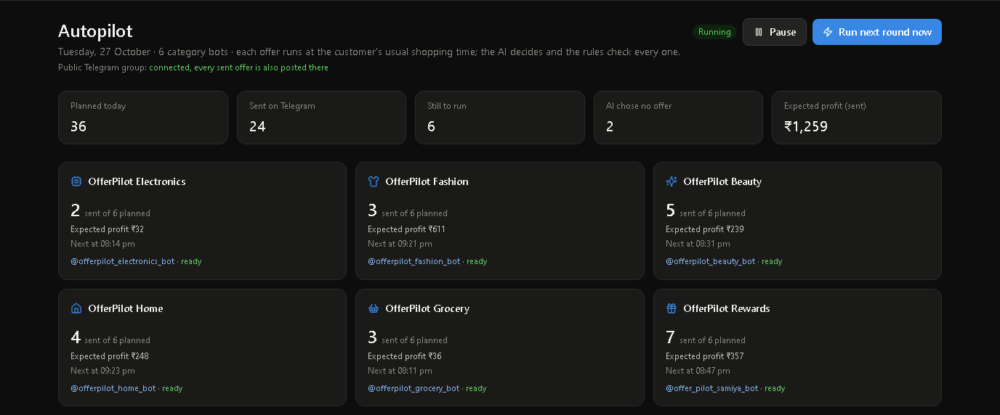

| Every decision explains itself | "No offer" is a decision too |
|---|---|
| 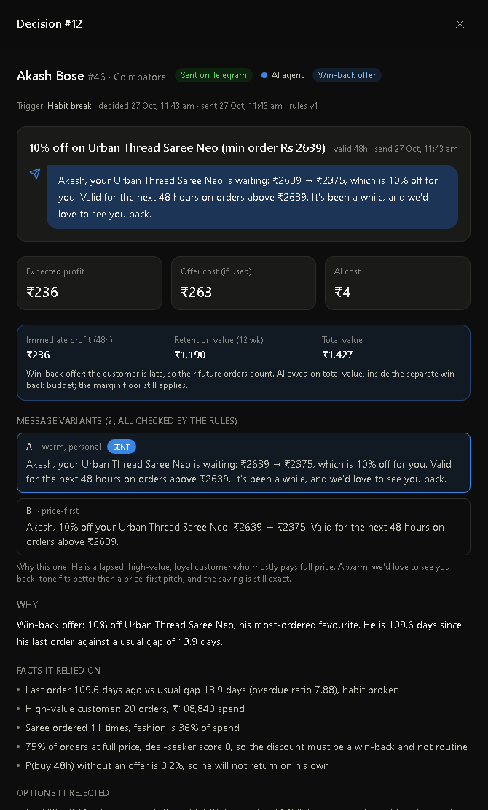 | 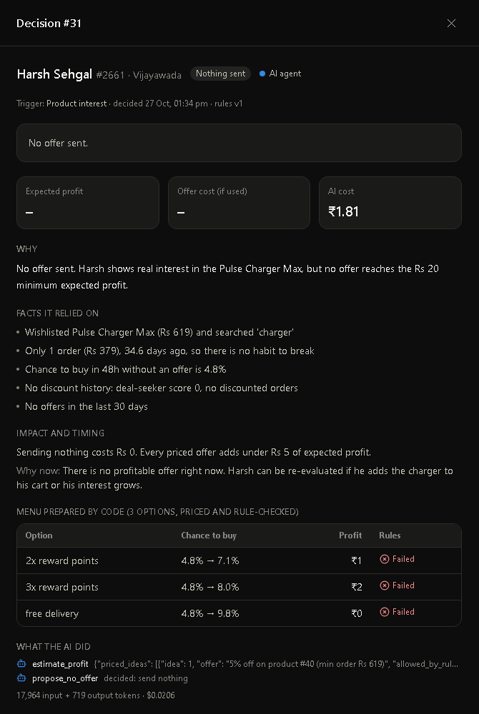 |

| Customers: make one offer by hand | Guardrails: budgets, circuit breaker, proof |
|---|---|
| 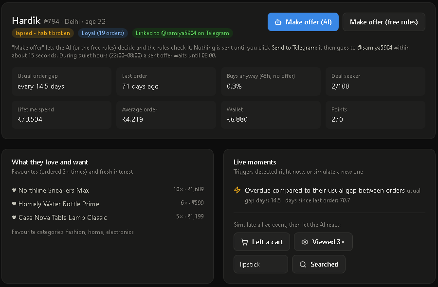 | 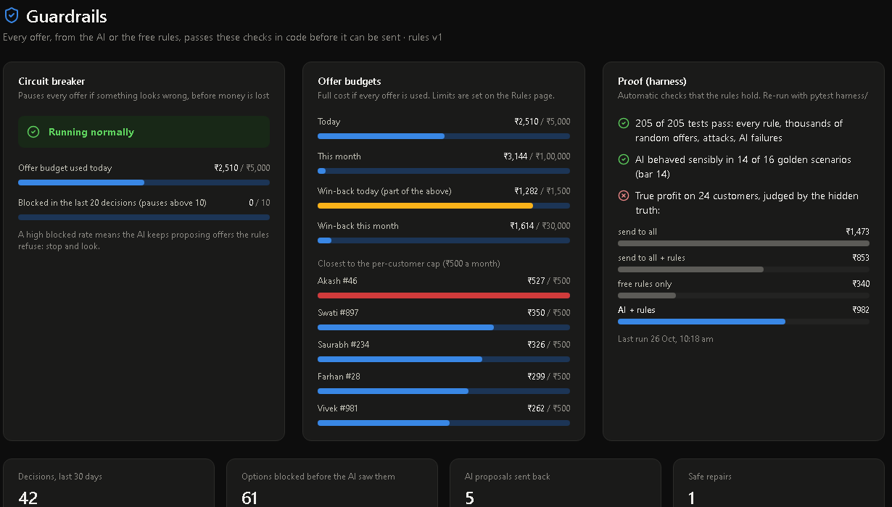 |

**Telegram: each offer is sent by the bot of its category** (real messages, 27 Oct 2026)

| Electronics | Fashion | Beauty |
|---|---|---|
| 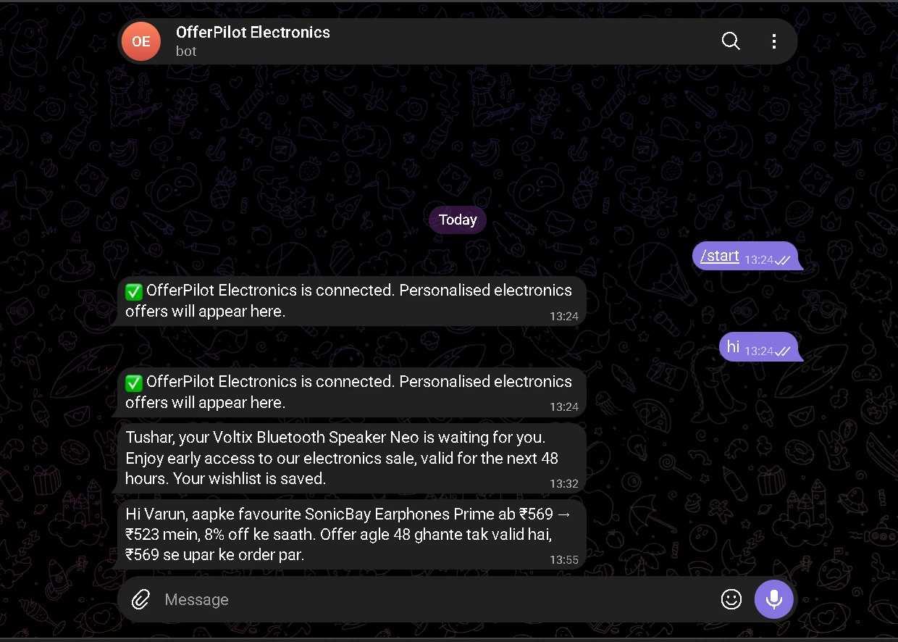 | 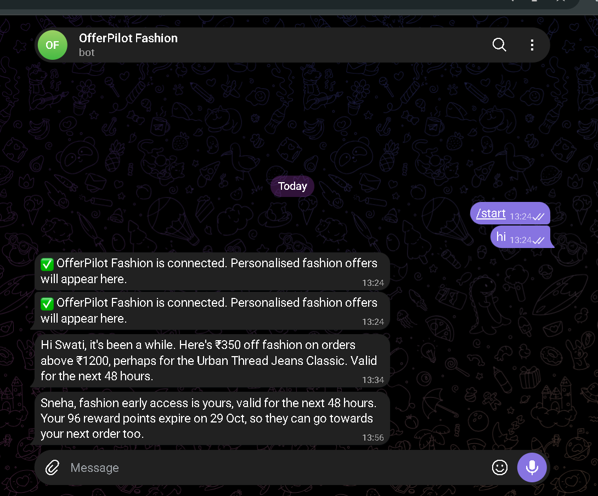 | 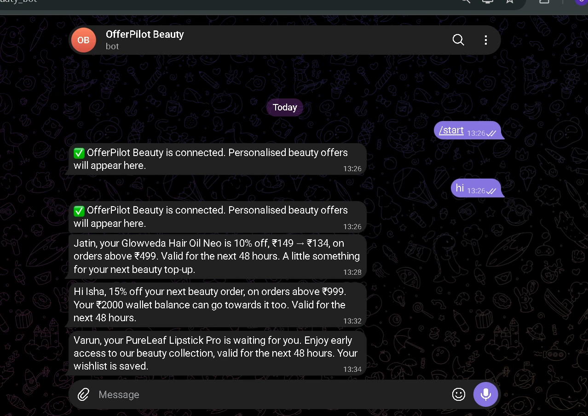 |

| Home | Grocery | Rewards |
|---|---|---|
| 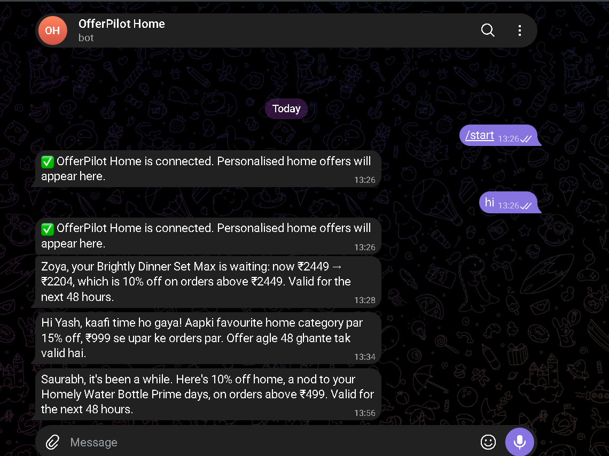 | 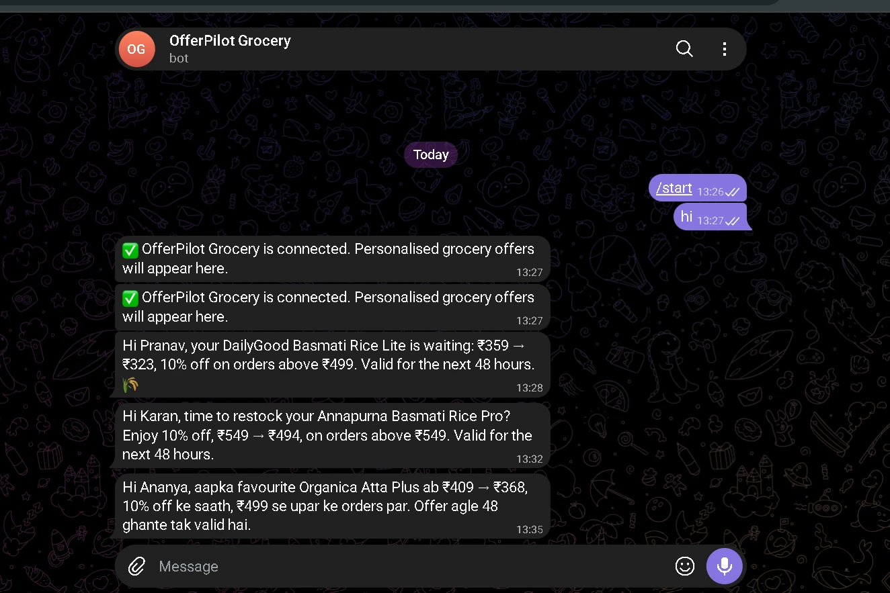 | 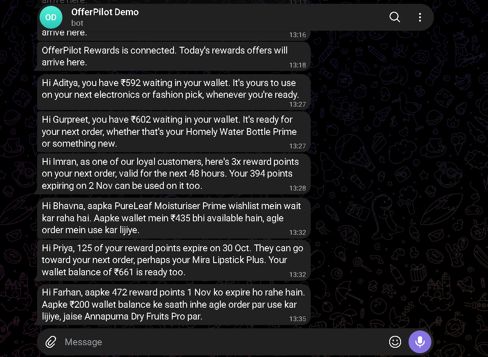 |

More dashboard screenshots: [docs/screenshots/](docs/screenshots/).

## Results (scored against hidden ground truth)

| Check | Result |
|---|---|
| True 12-week profit, 24 customers across 8 hidden personas (v2 data and referee) | AI + rules **₹1,515** (v1 engine ₹1,709), free rules ₹388, send an offer to everyone **₹2,692**: send-to-all still wins over 12 weeks on this referee (see "v2 results" in [documentation.md](documentation.md)) |
| Full-price share of orders in the next 12 weeks | AI + rules 59% (v1 engine 59%), send to all 55%, no offers 65% |
| Offers sent | AI + rules 21 of 24 (v1 engine 22) |
| AI behaviour in 16 golden scenarios | 14/16 (pass bar 14), reasoning complete in all 16 |
| Automatic tests | 203 pass: every rule, thousands of random offers (hypothesis), attacks, every AI failure path, the CSV importer, the autopilot |
| Approved offers with negative total expected value | **0** (total = immediate profit + retention value, by construction); the **10% margin floor holds on every offer**. Normal offers also need ≥ ₹20 immediate profit; win-back offers may rely on retention value, inside their own smaller budget |
| Cost per AI decision | ~₹1.6–2.4 (Claude Sonnet 5.5, one call in most cases) |

Full outputs: [docs/evidence/](docs/evidence/).

## What this is and is not

- **For:** small D2C brands (a few thousand to a few lakh customers) who send offers by hand or by simple rules
  and want every offer to pay for itself, with the reasoning written down.
- **How it differs from CleverTap / MoEngage-style tools:** those are excellent at *sending* (segments, journeys,
  channels, A/B tests); the marketer still decides who gets what. OfferPilot decides the offer per customer, prices
  it with profit maths (including what a won-back customer is worth over 12 weeks), and refuses anything that breaks
  margin, budget, anti-spam, habit-protection or honesty rules. It could sit in front of such a tool.
- **Limits, honestly:** the results come from **synthetic data** (3,000 customers, 12 months, a hidden "true
  behaviour" we wrote ourselves); there is **no store**, so nobody actually redeems anything; the AI checks use small
  samples (24 customers) because each AI decision costs money. The CSV importer makes it run on a real export, but it
  has not been proven on one yet.

## What it does every day (autopilot + 6 Telegram bots)

- **Customer groups:** all 3,000 customers are grouped from what they actually do: About-to-leave VIP, Loyal
  regular, Deal hunter, Cart abandoner, Points collector, New customer, Everyday shopper. Each customer also gets a
  favourite category, the hour they usually shop, and their current reason for an offer (habit breaking, cart left,
  product interest, points expiring, idle wallet). `python -m engine.groups`
- **Autopilot:** every day it plans **6 offers per bot** (36 a day), mixing customer groups, and schedules each one at
  the hour that customer usually shops (09:00-21:30 IST). When a slot is due, the normal pipeline runs: the AI decides
  (or sends nothing), the rules check, and the offer goes out automatically. Pause / Resume and "Run next round now"
  are on the dashboard. Settings: `config/autopilot.yaml`.
- **Six category bots:** each offer is sent by the bot of its category. Offers with no category (points, wallet,
  free delivery on the whole order) go through the Rewards bot. Settings: `config/bots.yaml`.

| Bot | Telegram | Sends |
|---|---|---|
| OfferPilot Electronics | @offerpilot_electronics_bot | electronics offers |
| OfferPilot Fashion | @offerpilot_fashion_bot | fashion offers |
| OfferPilot Beauty | @offerpilot_beauty_bot | beauty offers |
| OfferPilot Home | @offerpilot_home_bot | home offers |
| OfferPilot Grocery | @offerpilot_grocery_bot | grocery offers |
| OfferPilot Rewards | @offer_pilot_samiya_bot (the original bot) | points, wallet, whole-order offers; also handles /start links |

- **Demo mode (manager mode):** every message goes to one Telegram account (`TELEGRAM_MANAGER_USERNAME` in `.env`),
  exactly as the customer would see it. Who it was for and why is on the dashboard. Leave the setting empty to send
  each offer to the tester linked to that customer instead.
- **Public showcase group:** every sent offer is also posted, by the same bot, in the Telegram group
  *OfferPilot Live Offers* (https://t.me/+LyvVlulkewU4Yjg1), so anyone can watch the six bots working.
- **Dashboard home = Autopilot:** one card per bot (sent / planned, expected profit, next send), then today's offers
  in time order: customer, group, reason, offer, the exact Telegram message, why, and the money. Click any offer for
  the AI's full reasoning and every rule check.

## How it decides

```
SQLite data (3,000 customers, 12 months)          past campaigns with random holdout groups
        │                                                    │
        ▼                                                    ▼
 Analyst profile (habit, interests, wallet, points)   Uplift model: who buys BECAUSE of an offer
        │
 Trigger: habit break / cart left / product interest / points expiring / idle wallet / manager clicks "Run agent"
        │
 Menu: code builds and prices 6-10 personalised offers, each already checked by the rules
        │
 Gatekeeper (free): skip anyone no offer could reach; check today's AI budget ("Plan your day")
        │
 AI agent (Claude): picks / adapts an offer, or sends nothing, or WAITS to see if they buy on their own;
        │            writes the message in the brand voice and the reasoning for the manager
        ▼
 Rules checker (plain code): approve / repair / reject → 2 rejections or any AI failure → free fallback rules
        │
 Telegram bot (linked testers) or "would send" ── follow-ups resolve every "wait" decision
        │
 Dashboard: decisions + reasoning, customers, testers, guardrails, editable rules (versioned)
```

Key ideas:
- **Profit is maths, not the AI.** `expected_profit = P(buy | offer) × margin_after_offer − P(buy | no offer) × normal_margin`,
  computed in [engine/profit.py](engine/profit.py) and calibrated on past campaigns. Discounts to people who'd buy
  anyway count as a loss, so they're refused.
- **The AI only chooses inside the limits.** The Claude API key is used in exactly one file, [engine/agent.py](engine/agent.py).
  Everything else — data, profit, rules, fallback, bot, dashboard — is plain code.
- **Every decision is explained:** summary, facts used, options rejected (with their numbers), expected impact, why
  now, every rule check, the priced menu, tokens and cost.
- **Honest messages:** a "valid till midnight" must match the real expiry, "loyal customer" must be true, no fake
  urgency or unbacked claims, the amount in the text must match the offer.
- **Marketing edits the rules** on the dashboard; every save is a new version, unsafe values are refused, and offers
  not yet sent are re-checked.
- **Long-term value (win-back):** for a customer whose habit is slipping, the value of an offer includes what they
  are worth over the next 12 weeks if they come back (`retention_value`). Offers that rely on it are *win-back
  offers*: shown with their own badge, inside a separate budget, margin floor unchanged.
- **Habit protection:** customers who mostly pay full price get no cash discounts (only early access, bonus points or
  free delivery) unless it's a win-back; coupons would teach them to wait for deals. The simulation measures the
  full-price share of orders over 12 weeks for every approach.
- **Message variants:** the AI writes 2-3 variants in different tones (and Hinglish for Hindi-speaking customers);
  every variant is checked, the sent one is recorded so reply rates can be compared later. Price anchors
  ("₹799 → ₹719") are allowed only with the catalog's real numbers.
- **Real data:** `python -m data.import_csv` loads a brand's customers, products (with cost) and orders into a new
  database; without past campaigns it runs in learning mode (no model, conservative estimates, a 10% holdout).
  Guide: [docs/csv_import/README.md](docs/csv_import/README.md).

Why each part works this way: [reasoning.md](reasoning.md). The full rulebook: [CLAUDE.md](CLAUDE.md).

## Run it

Needs Python 3.11+ and Node 18+.

**First time (setup):**
```bash
pip install -r requirements.txt
cp .env.example .env          # then fill it in, see the table below
python -m data.generate --customers 3000 --months 12    # ~170 MB SQLite database, a few minutes
python -m engine.uplift --train                         # uplift model, ~2 min, no API
python -m engine.groups                                 # customer groups for the autopilot, ~2-3 min, no API
cd dashboard && npm install && npm run build && cd ..
```

**Every time:** double-click **`start_offerpilot.bat`** (Windows), or run these two in separate terminals:
```bash
python -m uvicorn api.main:app --port 8010              # dashboard + API + autopilot -> http://127.0.0.1:8010
python -u -m bot.telegram_bot                            # the Telegram bots
```

**`.env` settings:**
| Setting | What it is |
|---|---|
| `ANTHROPIC_API_KEY` | Claude API key (only `engine/agent.py` uses it). Empty = the free rules decide everything. |
| `TELEGRAM_BOT_TOKEN`, `TELEGRAM_BOT_USERNAME` | The main bot = OfferPilot Rewards (also handles tester links). |
| `TELEGRAM_BOT_TOKEN_ELECTRONICS` … `_GROCERY` | One token per category bot from @BotFather. Empty = that category uses the main bot. |
| `TELEGRAM_MANAGER_USERNAME` | Demo mode: every offer goes to this Telegram user. |
| `MAX_AGENT_RUNS_PER_DAY` | Hard ceiling on AI decisions per day (default 50, about ₹100). |
| `DASHBOARD_PASSWORD` | Login for the dashboard. **Always set it when the dashboard is on the internet.** |
| `TELEGRAM_GROUP_CHAT_ID` | Optional: the public showcase group. Normally detected by itself when the bots are added to a group. |

Each bot can only message someone who has pressed **Start** in it once, so open every bot in Telegram and press Start.

- **No Claude key?** Everything still works: the free fallback rules decide, and are checked the same way.
- **No Telegram token?** Decisions are shown as "would send" on the dashboard.

Tests:
```bash
pytest harness/                          # 203 tests, no API, ~2 minutes
python -m harness.eval_uplift            # free: uplift model vs formula vs blend, against the hidden truth
python -m harness.eval_segments          # free: do the Testers page profiles match the hidden personas?
python -m harness.simulate_profit        # real AI on 24 customers, 48h + 12-week profit, full-price share
python -m harness.simulate_profit --skip-ai   # free: the same without the AI column
python -m harness.eval_agent_scenarios   # real AI, 16 golden scenarios
```

## Deploy

**Option 1: this laptop (fine for a demo).** Double-click `start_offerpilot.bat`. Keep both windows open: offers only
go out while they run, and the laptop must not sleep. After editing `.env`, close both windows and start again.

**Live now: https://offerpilot-samiya.fly.dev** (login: any username + the dashboard password).

**Option 2: always on, with Fly.io (ready: `Dockerfile`, `fly.toml`, `deploy/start.sh`).** One small machine in
Singapore (Fly has no Mumbai region) runs the dashboard + autopilot and all six bots; the database lives on a persistent volume. About $3-5 a month.
Run in PowerShell from the project folder (install flyctl first if needed: `iwr https://fly.io/install.ps1 -useb | iex`):
```powershell
fly auth login                                                          # once
fly apps create offerpilot-samiya                                       # pick another name if taken (also in fly.toml)
fly volumes create offerpilot_data --region sin --size 1 -a offerpilot-samiya
# secrets from .env (everything except DB_PATH and empty values), plus a dashboard password:
(Get-Content .env) | Where-Object { $_ -match '^[A-Z_]+=.+' -and $_ -notmatch '^DB_PATH=' } | fly secrets import -a offerpilot-samiya
fly secrets set DASHBOARD_PASSWORD=choose-a-strong-password -a offerpilot-samiya
# IMPORTANT: close the laptop's "Telegram bots" window first: only one copy of the bots may run
fly deploy --ha=false                                                   # ONE machine; builds and starts it (~5 min)
fly open                                                                # https://offerpilot-samiya.fly.dev (login: any name + your password)
fly logs                                                                # live logs: offers decided, bots sending
```
The first start copies `data/offerpilot.db` (uploaded with the build) onto the volume; later deploys keep the live
data. Keep it at **one machine** (never `fly scale count 2`). To stop it: `fly scale count 0`.

**Option 3: any Linux server (VM).** Clone the repo, copy `.env`, `data/offerpilot.db` and `models/uplift.joblib`,
`pip install -r requirements.txt`, build the dashboard, and run `bash deploy/start.sh` as a systemd service, with a
login in front of port 8080.

Telegram needs no webhook or public address: the bots poll Telegram, so they work from any machine with internet.
Run only **one** copy of the bot at a time (two copies polling the same token conflict).

## Demo in 5 minutes

1. **Autopilot** (home): six bot cards and today's 36 planned offers, each at the customer's usual shopping time.
   Point at one that was sent: customer, group, reason, the exact message, why, expected profit.
2. Click **Run next round now**: each bot runs its next offer; within ~15 seconds the messages arrive on your phone,
   each from its own category bot (show the six bot chats).
3. Click one offer: the AI's reasoning (facts used, options rejected with their numbers, win-back or normal) and every
   rule check.
4. **Customers** → any customer → **Make offer (AI)** → check the message → **Send to Telegram** (one offer by hand).
5. **Rules**: change the electronics cap 8% → 12%; it's saved as a new version and the next decision uses it.
6. **Guardrails**: what each rule caught, budgets, circuit breaker, and the proof from the tests.

Real-tester guide: [TESTING.md](TESTING.md).

## Repository map

| Folder | What's in it |
|---|---|
| `data/` | synthetic data generator (8 hidden personas, festivals, paydays, habits that break, discount training) and the CSV importer |
| `engine/` | profile, customer groups, autopilot, triggers, candidate menu, profit, uplift model, gatekeeper, agent, rules, fallback, follow-ups |
| `bot/` | Telegram bots (6 category bots), manager mode, tester linking / re-linking, delivery |
| `api/` | FastAPI for the dashboard (no decision logic of its own) |
| `dashboard/` | React + Vite + Tailwind + Recharts |
| `harness/` | tests and AI checks (the only code besides the generator that may read the hidden truth) |
| `config/` | rules, offer types, message templates, brand voice, bots, autopilot |
| `docs/evidence/` | saved outputs of real runs |
| `docs/csv_import/` | column mapping example, sample brand export, import guide |

Build log, step by step: [documentation.md](documentation.md).

Made by Samiya Sehgal (2302662).
